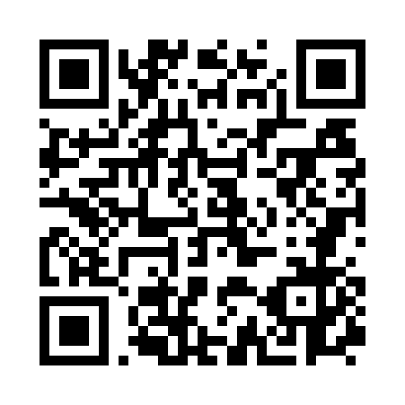

# Chấm Phiếu

Ứng dụng web chấm phiếu trắc nghiệm 50 câu bằng camera hoặc ảnh chụp, chạy ngay trên trình duyệt (tối ưu cho Safari trên iPhone). Bố cục phiếu và cách chấm theo kiểu ZipGrade.

## Đường dẫn

| Mục | Địa chỉ |
|---|---|
| Ứng dụng (mở bằng Safari) | https://nguyenchivot-create.github.io/champhieu/ |
| Mã nguồn trên GitHub | https://github.com/nguyenchivot-create/champhieu |

### Quét mã QR để mở ứng dụng

  

Dùng camera điện thoại quét mã trên để mở thẳng ứng dụng bằng trình duyệt, không cần cài đặt. Nếu quét bằng ứng dụng khác mà mở trong khung nhúng, hãy chọn "Mở bằng Safari" để dữ liệu được lưu đúng chỗ.

## Tính năng chính

- **Chấm bằng camera hoặc ảnh:** chụp từng phiếu, hoặc chấm liên tục (đưa phiếu mới vào khung, máy tự nhận và lưu).
- **Nhận dạng:** đọc đáp án A đến E của 50 câu, ID sinh viên, mã đề, và cắt ảnh ô tên viết tay.
- **Đáp án theo mã đề:** nhập đáp án cho từng mã đề A đến E, hỗ trợ chấm điểm từng phần và điểm riêng từng câu.
- **Nhiều bài kiểm tra:** mỗi bài có thang điểm, điểm đạt, danh sách lớp (ID và họ tên) riêng.
- **Xem lại từng bài:** ảnh phiếu đã nắn thẳng với dấu đúng, sai trên từng ô, sửa đáp án bằng tay, chuyển bài trước hoặc sau.
- **Thống kê:** Mean, Median, SD (mẫu, n-1), Min, Max, tỷ lệ đạt, phân bố điểm, tỷ lệ làm đúng từng câu.
- **Thẻ năng lực (tùy chọn):** gắn câu hỏi với chuẩn đầu ra (CLO, PLO...) để thống kê theo từng thẻ.
- **Xuất dữ liệu:** Excel, CSV, và PDF lưu trữ toàn bộ bài chấm (mỗi bài một trang, kèm bảng tổng hợp và trang thống kê cuối).
- **Sao lưu và khôi phục:** một file JSON (có thể kèm ảnh phiếu).
- **In phiếu:** tải sẵn file PDF phiếu 50 câu trong tab Phiếu in.

## Cách dùng nhanh

1. Mở ứng dụng bằng Safari tại địa chỉ ở trên.
2. Vào tab **Đáp án**, tạo bài kiểm tra và nhập đáp án cho mã đề.
3. Vào tab **Phiếu in**, tải và in phiếu cho sinh viên.
4. Vào tab **Chấm bài**, chụp phiếu đã tô hoặc chọn ảnh có sẵn, kiểm tra kết quả rồi lưu.
5. Vào tab **Kết quả** để xem danh sách, thống kê, xuất Excel, CSV, PDF và sao lưu.

Phiếu cần thấy đủ 6 ô vuông đen ở các góc và hai bên. Chụp thẳng, đủ sáng, không bị che.

## Dữ liệu và quyền riêng tư

- Toàn bộ dữ liệu (đáp án, bài đã chấm, ảnh phiếu) lưu ngay trong trình duyệt trên máy của bạn. Ứng dụng không có máy chủ và không tải dữ liệu đi đâu.
- Vì vậy nên **sao lưu định kỳ** (tab Kết quả, kéo xuống cuối, bấm "Sao lưu về máy"), nhất là trước khi xóa lịch sử Safari hoặc đổi máy.
- Trên iPhone, ứng dụng mở từ biểu tượng Màn hình chính có kho dữ liệu riêng, tách khỏi Safari. Muốn chuyển dữ liệu, sao lưu ở một nơi rồi khôi phục ở nơi kia.
- Khôi phục luôn thêm thành bài kiểm tra mới, không gộp vào bài cũ. Bài trùng tên được thêm số 1, 2... phía sau.

## Thêm vào Màn hình chính (iPhone)

1. Mở ứng dụng bằng Safari, bấm nút Chia sẻ.
2. Chọn **Thêm vào Màn hình chính**.
3. Nếu muốn dùng chung dữ liệu với Safari, tắt tùy chọn "Mở dưới dạng ứng dụng web".

## Giới hạn hiện tại

- Chỉ hỗ trợ phiếu 50 câu, mỗi câu 5 lựa chọn A đến E.
- Phiếu phải được chụp đúng chiều dọc, chưa tự xoay 90 độ.
- Chưa đồng bộ đám mây. Chuyển dữ liệu giữa các máy bằng file sao lưu.
- Độ chính xác với phiếu chụp thực tế phụ thuộc ánh sáng và nét tô. Ô máy chưa chắc được đánh dấu để kiểm tra lại, nên xem lại các bài có cảnh báo trước khi chốt điểm.

## Cấu trúc kho

| Tệp | Nội dung |
|---|---|
| `index.html` | Toàn bộ ứng dụng trong một tệp (giao diện, bộ nhận dạng phiếu, thư viện xuất Excel) |
| `apple-touch-icon.png` | Biểu tượng khi thêm vào Màn hình chính iPhone |
| `icon-512.png` | Biểu tượng kích thước lớn |
| `qr-champhieu.png` | Mã QR dẫn tới ứng dụng |

Trang được phát hành qua GitHub Pages từ nhánh `main`.
